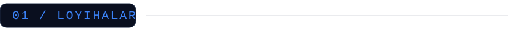
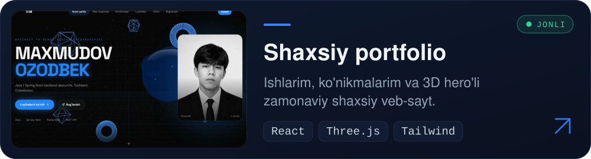
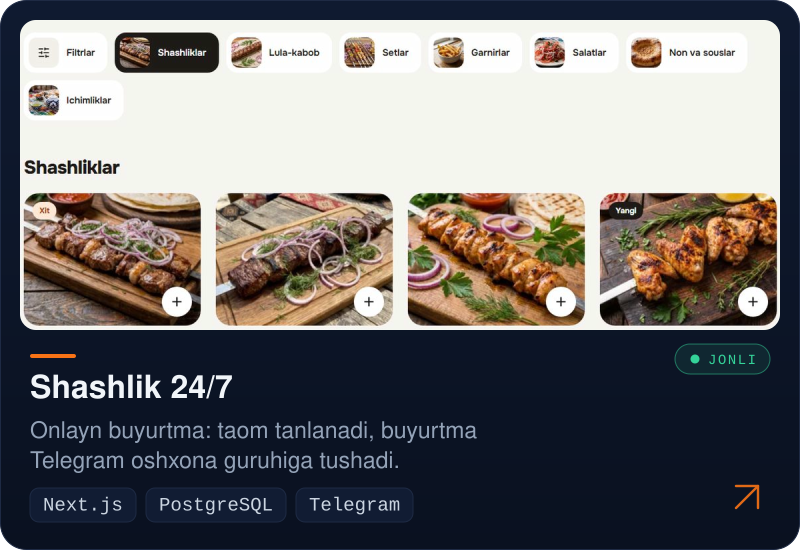
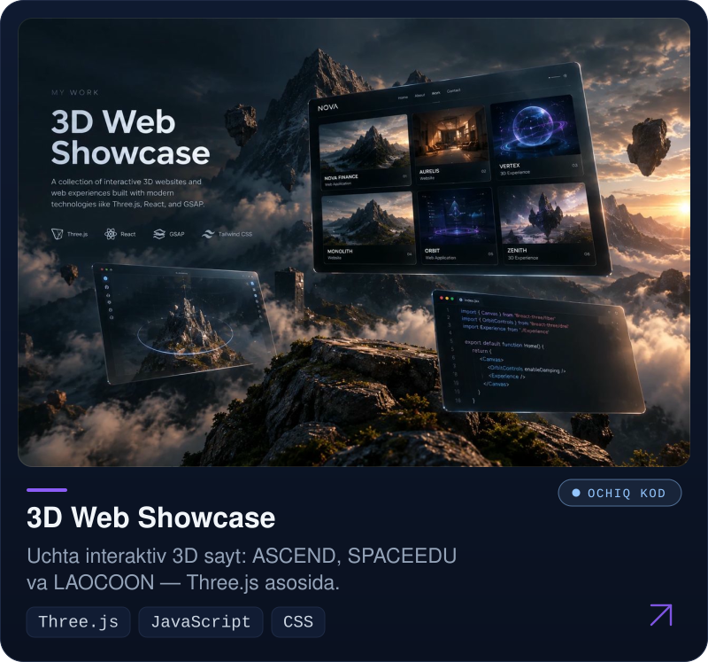
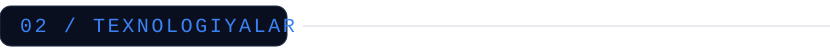
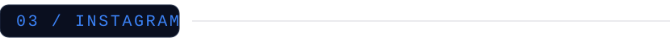
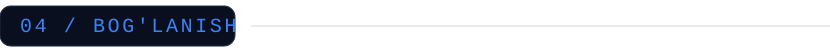

  

  Java va Spring ekotizimida backend tizimlar, onlayn buyurtma saytlari 
  hamda interaktiv 3D veb-loyihalar quraman. 
  SBUMIPTK universitetida dastur injiniringi yo'nalishida o'qiyman.

  
  
  

 

  

  

  

 

  <picture>
    <source media="(prefers-color-scheme: light)" srcset="https://skillicons.dev/icons?i=java,spring,postgres,mysql,ts,react,nextjs,threejs,tailwind,docker,git&theme=light&perline=6">
    
  </picture>

 

  

 

  Telegram: <a href="https://t.me/Maxmudovozodbekk">@Maxmudovozodbekk</a>
  &nbsp;·&nbsp;
  Instagram: <a href="https://www.instagram.com/ozodbekmaxmudov48">@ozodbekmaxmudov48</a>

